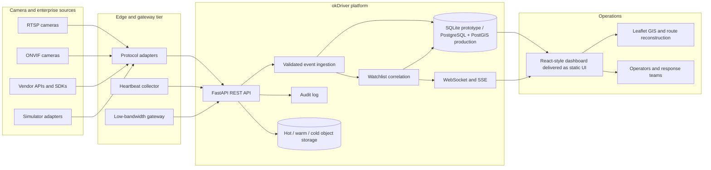

# okDriver Smart CCTV Command

A working full-stack prototype for the okDriver Smart Dashcams full-stack hiring assignment and the Gujarat Police Innovation Hackathon 2026 scenario.

The prototype demonstrates a hybrid **CCTV registry + unified viewing + metadata analytics + watchlist alerting** workflow. It is designed to run locally without external infrastructure while preserving clear seams for RTSP, ONVIF, vendor APIs, WebRTC/HLS, PostgreSQL/PostGIS, Redis/Kafka, and regional/edge deployments.

## What is implemented

- Camera registry with manual and API onboarding, bulk onboarding, edit, soft-disable, search, filters, CSV export, health state, heartbeat history, and audit records.
- Two logically different source adapters: RTSP and ONVIF. Both are safe, documented simulators in this prototype; production adapters can be added without changing the registry or event workflow.
- Near-live feed tiles and a responsive operational dashboard with Leaflet GIS markers, status colors, camera health, activity, event search, and watchlist alerts.
- Analytics event API for ANPR, vehicle, person, and object events with validation, confidence, bounding boxes, speed, metadata, timestamps, and idempotency keys.
- Event deduplication and correlation against active synthetic watchlist records.
- Immediate alert creation with camera, coordinates, zone, confidence, severity, status, acknowledgement, resolution, and audit history.
- WebSocket and Server-Sent Events real-time channels. New detections, matches, alert transitions, and camera health changes reach the dashboard without a refresh.
- Vehicle/entity search with chronological movement history and route reconstruction.
- Role-based authentication with `admin` and `operator` roles, signed HTTP-only session cookies, bearer-token support, rate limiting, security headers, validation, and secret-free stream references.
- OpenAPI documentation at `/docs`, ReDoc at `/redoc`, and machine-readable schema at `/openapi.json`.
- Automated API tests, Docker deployment files, sample camera/watchlist datasets, architecture diagram, ER diagram, security note, scalability note, and demo-video script.

## Quick start

Requirements: Python 3.11+ and Node.js is optional for the dashboard (the dashboard is served as static assets; no build step is required). Install `requirements-dev.txt` when running the optional Ruff and mypy checks.

```bash
cp .env.example .env
python -m venv .venv
.venv/bin/pip install -r requirements.txt
.venv/bin/uvicorn app.main:app --reload
```

Open `http://localhost:8000`.

The default development seed creates synthetic users, six representative camera sources, three watchlist records, and three historical ANPR observations for `GJ01AB1234`.

### Development credentials

| Role | Username | Password |
| --- | --- | --- |
| Admin | `admin` | `ChangeMe123!` |
| Operator | `operator` | `Operator123!` |

These are intentionally synthetic development credentials. Set `SECRET_KEY`, replace or disable seed users, and use an identity provider before any deployment. Do not reuse these values outside a local demo.

### Configuration

Copy `.env.example` and change values as needed:

| Variable | Purpose | Default |
| --- | --- | --- |
| `DATABASE_URL` | SQLAlchemy connection URL | `sqlite:///./okdriver.db` |
| `SECRET_KEY` | HMAC signing secret for access tokens | development-only value |
| `DEMO_ADMIN_PASSWORD` | Synthetic admin seed password; replace outside local demos | `ChangeMe123!` |
| `DEMO_OPERATOR_PASSWORD` | Synthetic operator seed password; replace outside local demos | `Operator123!` |
| `ANALYTICS_API_KEY` | Optional service key for external event ingestion | unset |
| `TOKEN_TTL_MINUTES` | Access-token lifetime | `480` |
| `COOKIE_SECURE` | Require HTTPS for the session cookie | `false` |
| `SIMULATOR_ENABLED` | Periodic synthetic analytics events | `true` |
| `SIMULATOR_INTERVAL_SECONDS` | Synthetic event cadence | `20` |
| `HEARTBEAT_ENABLED` | Synthetic heartbeat collector for `sim://` sources | `true` |
| `HEARTBEAT_INTERVAL_SECONDS` | Synthetic heartbeat cycle | `30` |
| `SEED_DEMO_DATA` | Insert the synthetic demo dataset | `true` |
| `CORS_ORIGINS` | Comma-separated allowed origins | `http://localhost:8000` |
| `RATE_LIMIT_PER_MINUTE` | Per-client API budget | `120` |
| `MAP_TILE_URL` | Leaflet raster tile template; must contain `{z}`, `{x}`, and `{y}` | `https://tile.openstreetmap.org/{z}/{x}/{y}.png` |
| `MAP_ATTRIBUTION` | Required visible provider attribution HTML | OpenStreetMap contributors and issue-report link |
| `MAP_MAX_ZOOM` | Maximum map zoom level | `19` |

The default tile URL is the exact OpenStreetMap Standard endpoint and the app sends a cross-origin `Referer` while preserving browser caching. Use it only for low-volume interactive development. Before public or production deployment, set `MAP_TILE_URL` and `MAP_ATTRIBUTION` to an approved provider or self-hosted tile service, follow that provider’s terms, and do not add bulk/offline prefetching.

For a quiet automated test run, set `SIMULATOR_ENABLED=false` and use a temporary `DATABASE_URL`.

## Docker

```bash
docker compose up --build
```

The service is exposed on `http://localhost:8000`. The compose file uses a named volume for the SQLite prototype database. For production, use PostgreSQL/PostGIS, a reverse proxy with TLS, object storage, and a queue rather than the prototype SQLite volume.

## End-to-end demonstration

1. Log in as `admin`.
2. Open **Camera registry**, add or edit a camera. The same metadata appears on the dashboard and Leaflet map.
3. Open a live tile or call `GET /api/v1/cameras/C001/stream` to view the near-live RTSP adapter.
4. Click **Simulate detection** on Overview, or use the **Emit sample event** button in Analytics events.
5. The backend validates and persists the event, normalizes `GJ01AB1234`, matches the active watchlist, creates one alert, and broadcasts the result over WebSocket.
6. Open **Alert center** to acknowledge or resolve the alert.
7. Open **GIS & movement**, trace `GJ01AB1234`, and inspect the chronological camera route.
8. Use **View registry**, CSV export, and the API docs to show persistence and operator workflows.

A short recording runbook is in [`docs/DEMO_VIDEO.md`](docs/DEMO_VIDEO.md). The supplied simulator is an operational backend demonstration; replace its adapter with a legally usable feed for a production or government-feed demonstration.

## API surface

All protected endpoints accept either the `okdriver_token` HTTP-only cookie or `Authorization: Bearer <token>`. The analytics ingestion endpoint also accepts the configured `X-Analytics-Key` for service integrations; other endpoints remain session/RBAC protected.

| Area | Endpoints |
| --- | --- |
| Authentication | `POST /api/v1/auth/login`, `POST /api/v1/auth/logout`, `GET /api/v1/auth/me` |
| Camera registry | `GET/POST /api/v1/cameras`, `GET/PATCH/DELETE /api/v1/cameras/{camera_id}` |
| Onboarding | `POST /api/v1/cameras/onboard`, `POST /api/v1/cameras/bulk` |
| Registry operations | `GET /api/v1/cameras/export.csv`, `GET /api/v1/cameras/gap-analysis` |
| Health and feeds | `POST /api/v1/cameras/{camera_id}/heartbeat`, `GET /api/v1/cameras/{camera_id}/stream`, `GET /api/v1/cameras/{camera_id}/status-history` |
| Watchlist | `GET/POST /api/v1/watchlist`, `GET/PATCH/DELETE /api/v1/watchlist/{entry_id}` |
| Analytics | `POST/GET /api/v1/events`, `GET /api/v1/events/entities/{identifier}/history` |
| Simulation | `POST /api/v1/events/simulator/emit`, `POST /api/v1/events/simulator/tick` |
| Alerts | `GET /api/v1/alerts`, `POST /api/v1/alerts/{id}/acknowledge`, `POST /api/v1/alerts/{id}/resolve` |
| Dashboard | `GET /api/v1/dashboard/stats`, `/activity`, `/recent` |
| Real time | `WS /ws`, `GET /api/v1/realtime/stream` |
| Health | `GET /api/v1/system/health`, `GET /api/v1/system/readiness` |

### Analytics event example

```bash
curl -X POST http://localhost:8000/api/v1/events \
  -H 'Content-Type: application/json' \
  -b cookies.txt \
  -d '{
    "camera_id": "C001",
    "event_type": "ANPR",
    "entity_type": "VEHICLE",
    "vehicle_number": "GJ01AB1234",
    "confidence": 0.98,
    "vehicle_type": "CAR",
    "bounding_box": {"x": 312, "y": 248, "width": 160, "height": 72},
    "metadata": {"adapter": "rtsp", "simulated": true},
    "idempotency_key": "edge-c001-20260925-0001"
  }'
```

The response contains the persisted event, any generated alert, and `duplicate`. Reusing the same idempotency key returns the original event without creating another alert.

## Architecture



The current implementation uses SQLite to make the submission runnable on one machine. A PostgreSQL/PostGIS production baseline with spatial, foreign-key, and time indexes is provided in [`sql/postgres_postgis.sql`](sql/postgres_postgis.sql); the service boundaries also support an event bus and horizontally scaled workers.

## Repository layout

```text
app/
  main.py                         FastAPI application, middleware, lifespan jobs
  config.py                       Environment configuration
  database.py                     SQLAlchemy engine and session dependency
  models.py                       Relational domain model
  schemas.py                      Pydantic request/response contracts
  security.py                     Password hashing and signed access tokens
  dependencies.py                 Authentication and role dependencies
  realtime.py                     WebSocket/SSE broadcast manager
  seed.py                         Synthetic users, cameras, watchlist, events
  api/routes/                     REST and real-time route modules
  services/                       Adapters, ingestion, audit, background jobs
static/                             Responsive dashboard, CSS, browser JavaScript
sql/schema.sql                      Portable SQLite relational schema
sql/postgres_postgis.sql            PostgreSQL/PostGIS production baseline
 data/                               Sample 50-camera and watchlist datasets
tests/                              API, RBAC, deduplication, and WebSocket tests
docs/                               Architecture, HLD, security, scale, API, demo notes
Dockerfile                          Production-style container definition
docker-compose.yml                  Local compose deployment
```

## Database and event semantics

- `cameras` stores normalized asset metadata, protocol, storage reference, location, health, and audit linkage.
- `camera_status_history` records heartbeat/status transitions.
- `analytics_events` stores immutable inference observations and a unique `event_key`.
- `watchlist_entries` stores synthetic or approved entity records.
- `alerts` has a unique `event_id`, preventing one event from generating uncontrolled duplicate alerts.
- `audit_logs` records authentication, onboarding, metadata changes, heartbeats, event ingestion, and alert actions.
- Entity history orders observations by `occurred_at` and returns a `[longitude, latitude]` route for Leaflet.

The complete SQLite relational definition is in [`sql/schema.sql`](sql/schema.sql); the PostgreSQL/PostGIS production baseline is in [`sql/postgres_postgis.sql`](sql/postgres_postgis.sql), and the ER diagram is in [`docs/ER_DIAGRAM.md`](docs/ER_DIAGRAM.md).

## Security posture

Implemented controls include PBKDF2 password hashing, signed expiring tokens, HTTP-only cookies, RBAC, Pydantic bounds validation, secret-free stream-reference validation, audit logs, request rate limiting, CORS configuration, security headers, parameterized SQLAlchemy queries, and no real credentials in URLs or source control. The seeded passwords are synthetic development defaults and should be overridden before deployment. The synthetic heartbeat worker only probes `sim://` sources and never promotes a real camera to online without an explicit health report.

Production requirements are detailed in [`docs/SECURITY.md`](docs/SECURITY.md): TLS termination, network segmentation, managed secrets, mTLS/service identity, database encryption, retention/privacy controls, centralized audit storage, and a real gateway credential-vault integration. In `production`, startup rejects development or placeholder signing keys, insecure cookies, demo seeding/passwords, the simulator, and the synthetic heartbeat worker by default.

## Scale and deployment path

[`docs/SCALABILITY.md`](docs/SCALABILITY.md) covers the path toward approximately 80,000 cameras: edge/regional/central compute, GPU sizing, bandwidth, HLS/WebRTC policy, hot/warm/cold storage, PostgreSQL/PostGIS indexing, Redis/Kafka, horizontal workers, load balancing, observability, high availability, disaster recovery, security, and indicative cost bands.

## Verification

```bash
.venv/bin/pytest -q
.venv/bin/python -m compileall -q app
.venv/bin/ruff check app tests
.venv/bin/mypy app
node --check static/app.js
```

The test suite covers protected API access, login, camera CRUD and soft-disable, feed output, gap analysis, event validation, service-key ingestion, watchlist correlation, idempotency, route history, alert acknowledgement/resolution, RBAC, WebSocket connectivity, simulator output, dashboard statistics, and readiness.

## Deliverables map

- Working source code: this repository.
- Setup, architecture, environment, APIs, and limitations: [`README.md`](README.md).
- Architecture and HLD: [`docs/ARCHITECTURE.md`](docs/ARCHITECTURE.md) and [`docs/HLD.md`](docs/HLD.md).
- API reference and examples: interactive `/docs`, [`docs/API.md`](docs/API.md), and [`docs/API_EXAMPLES.md`](docs/API_EXAMPLES.md).
- Database schema and ER diagram: [`sql/schema.sql`](sql/schema.sql) and [`docs/ER_DIAGRAM.md`](docs/ER_DIAGRAM.md).
- Representative cameras: [`data/cameras_sample.csv`](data/cameras_sample.csv).
- Representative watchlist: [`data/watchlist_sample.json`](data/watchlist_sample.json).
- Security: [`docs/SECURITY.md`](docs/SECURITY.md).
- Integration and adapter contract: [`docs/INTEGRATION.md`](docs/INTEGRATION.md).
- Scalability and deployment: [`docs/SCALABILITY.md`](docs/SCALABILITY.md) and [`docs/DEPLOYMENT.md`](docs/DEPLOYMENT.md).
- Cost, PostgreSQL/PostGIS, and compliance notes: [`docs/COST_BENEFIT.md`](docs/COST_BENEFIT.md), [`sql/postgres_postgis.sql`](sql/postgres_postgis.sql), and [`docs/ASSIGNMENT_CHECKLIST.md`](docs/ASSIGNMENT_CHECKLIST.md).
- Demonstration runbook: [`docs/DEMO_VIDEO.md`](docs/DEMO_VIDEO.md).

## Known limitations

1. The default feeds are deterministic simulated SVG streams, not real RTSP/ONVIF video. The adapter boundary and event workflow are operational, but a real deployment must supply legally usable feeds, credentials, transcoding, and browser-compatible WebRTC/HLS delivery.
2. SQLite is a single-node prototype store. Multi-worker production use requires PostgreSQL/PostGIS, migrations, a queue, shared cache, and an external WebSocket fan-out service.
3. Matching is normalized exact identifier correlation. Production should add approved fuzzy matching, temporal suppression, confidence thresholds, and source-specific normalization rules.
4. The included watchlist is synthetic and must not be treated as an operational law-enforcement dataset.
5. The demo has no recorded video file in the repository; follow the included 3–5 minute runbook to record the working system.

## Reference

The official problem statement referenced by the assignment is available at <https://sentinel.gujarat.gov.in/problems>. This prototype is an independent implementation and does not claim to be an official government system.
