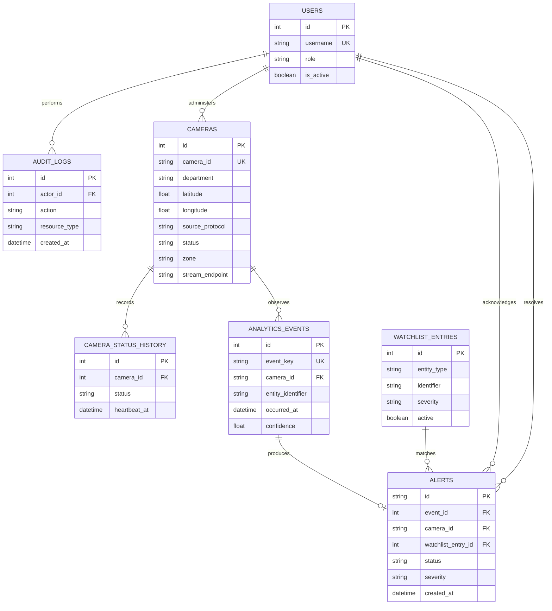

# Entity-Relationship Diagram

## Indexing rationale

- `cameras(camera_id)` provides stable source identity.
- `cameras(status, zone)` and `cameras(department, source_protocol)` support operational registry filters.
- `analytics_events(entity_identifier, occurred_at)` supports entity movement queries.
- `analytics_events(camera_id, occurred_at)` supports camera timelines and replay filtering.
- `watchlist_entries(identifier, active)` supports low-latency correlation.
- `alerts(status, severity)` supports the response queue.
- `alerts(event_id)` is unique and prevents duplicate alerts for one event.
- `audit_logs(resource_type, resource_id, created_at)` supports auditable history.

The production PostgreSQL/PostGIS baseline, including spatial types, foreign keys, and GiST/time indexes, is in [`sql/postgres_postgis.sql`](../sql/postgres_postgis.sql). Its identifiers and alert key types align with the SQLAlchemy models, and its time-oriented indexes support future event partitioning.
